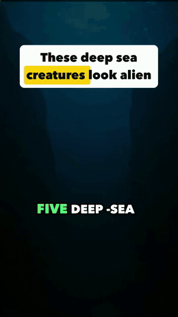
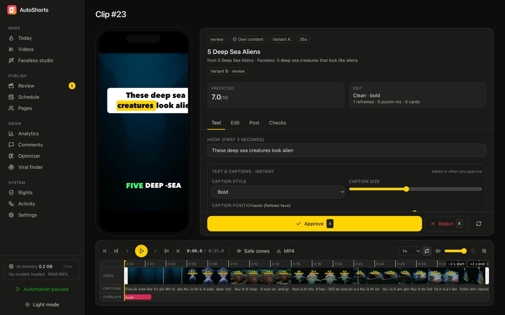
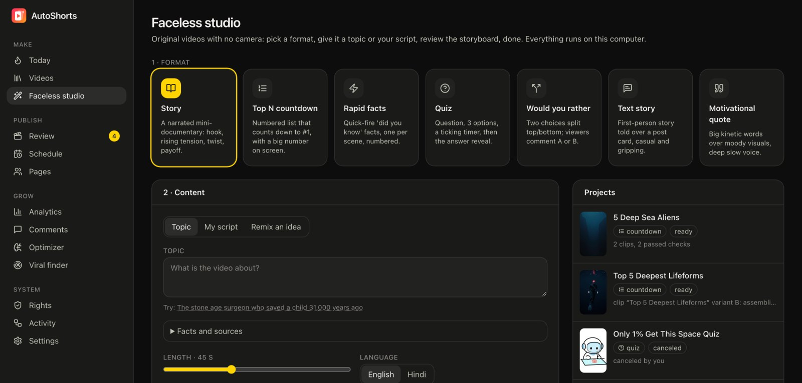
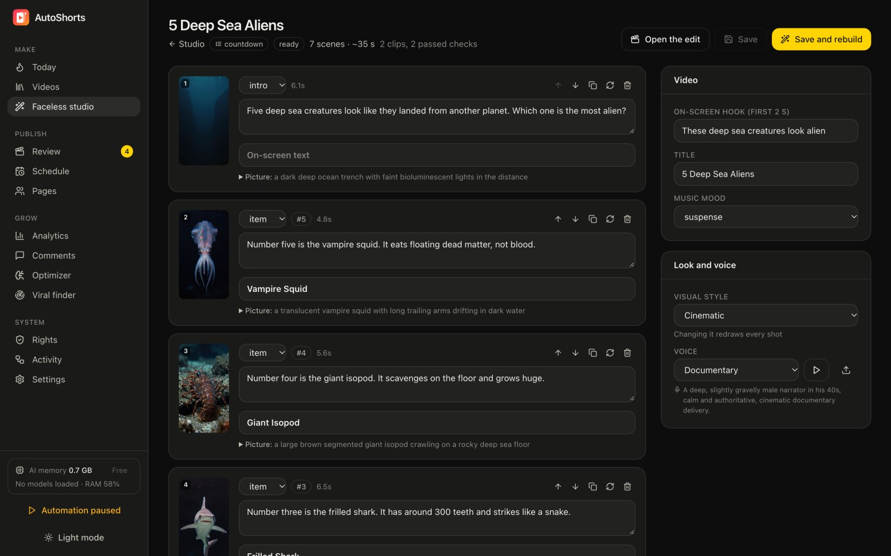
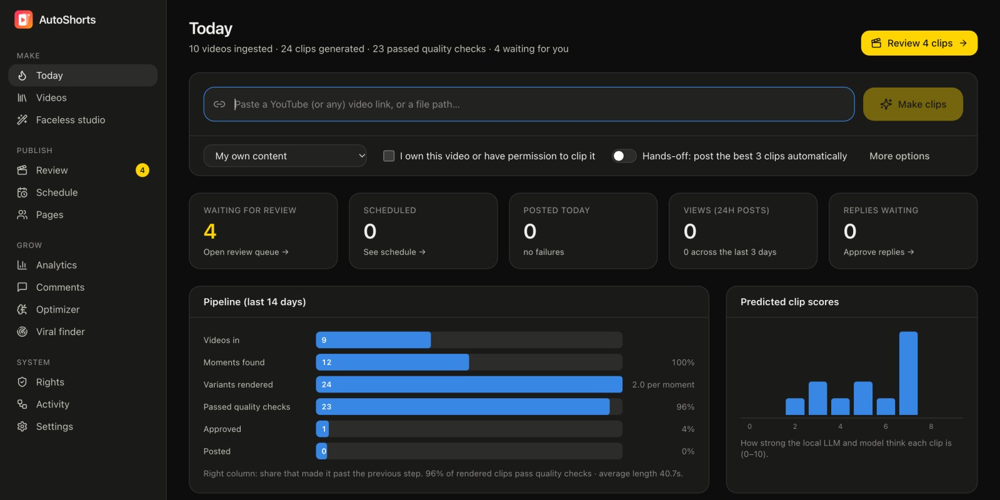

<div align="center">


# AutoShorts

**Turn long videos into viral Shorts and Reels, and make faceless videos, with AI that runs entirely on your own computer.**

No subscriptions. No per-minute credits. No uploads to anyone's cloud.

<p>
  
  
  
  
  <a href="https://github.com/shubhxtech/AutoShorts/actions/workflows/ci.yml"></a>
  <a href="LICENSE"></a>
  
  <a href="https://github.com/shubhxtech/AutoShorts/stargazers"></a>
</p>



<sub>Made start to finish by AutoShorts on a laptop: script, voice, pictures, edit, captions and music.</sub>

</div>

---

## What it does

Paste a link to a podcast or long video you have the rights to. AutoShorts finds the moments worth clipping, edits each one into a 9:16 short with the style top creators use, checks the result, and schedules it to your YouTube and Instagram accounts. Or give it a topic and it makes an original faceless video from scratch.

<table>
<tr>
<td width="50%">

**🎬 Clips from long videos**

- Finds complete moments (a hook question *and* its full answer), not random 30-second slices
- Follows whoever is speaking, with split-screen for two-person shots
- Animated captions, hook title on frame one, punch-ins on stressed words, jump cuts that remove dead air
- English and Hindi (Devanagari), including Hinglish

</td>
<td width="50%">

**🤖 Faceless studio**

- 7 formats: story, top-N countdown, rapid facts, quiz, would-you-rather, text story and quote
- Fact-checked scripts grounded in Wikipedia, or your own script
- Natural narrator voices and consistent characters, generated locally
- Storyboard editor: fix a line or redraw one picture without redoing the video

</td>
</tr>
<tr>
<td>

**⚡ Edit without waiting**

- Captions, hook and titles update instantly in the preview
- Changing the edit style takes seconds, not a full re-render
- Text is burned in only when you approve

</td>
<td>

**📈 Post and learn**

- Multiple YouTube channels and Instagram accounts through the official APIs
- Best-time scheduling per account, A/B variants, and a model that learns what performs
- Comment replies and comment-to-DM funnels for affiliate links

</td>
</tr>
</table>

## Why AutoShorts

| | Cloud clipping tools | AutoShorts |
|---|---|---|
| Cost | Monthly plans with minute or credit limits | Free and open source |
| Privacy | Your videos are uploaded to their servers | Nothing leaves your machine |
| Faceless videos | Usually a separate paid product | Built in, 7 formats |
| Hindi captions | Often weak or missing | Native Devanagari and Hinglish |
| Control | Their styles, their limits | Every step is editable, and the code is yours |

## Screenshots

<table>
<tr>
<td width="50%"><p align="center"><sub>Review: approve, reject or tweak; text edits are instant</sub></p></td>
<td width="50%"><p align="center"><sub>Faceless studio: pick a format, give a topic</sub></p></td>
</tr>
<tr>
<td><p align="center"><sub>Storyboard: edit lines, redraw single shots</sub></p></td>
<td><p align="center"><sub>Today: everything that happened, at a glance</sub></p></td>
</tr>
</table>

## Quick start

**macOS / Linux**

```bash
git clone https://github.com/shubhxtech/AutoShorts.git
cd AutoShorts
make setup && make up
```

On Linux, also install [Ollama](https://ollama.com) and run `ollama pull qwen3:8b`, plus the libraries text rendering needs: `sudo apt install ffmpeg libegl1 libgl1 libfontconfig1`.

**Windows** (PowerShell, in the repository folder)

```powershell
powershell -ExecutionPolicy Bypass -File scripts\setup_windows.ps1
scripts\start_windows.bat
```

Then open **http://localhost:3000**. Models download automatically the first time they're needed. No footage handy? Run `make demo`.

### Requirements

| | macOS | Windows / Linux |
|---|---|---|
| Hardware | Apple Silicon (M1 or newer) | Any 64-bit PC; an NVIDIA GPU (8 GB+) makes faceless images fast |
| RAM | 16 GB recommended (8 GB with the smaller model) | 16 GB recommended |
| Disk | About 20 GB for models | Same |

## How it works

```
link -> download -> transcribe (Whisper) -> align every word (wav2vec2) -> find moments (local LLM)
     -> render a master once -> assemble variants in seconds -> quality checks
     -> review with live text -> burn text on approve -> schedule -> publish -> learn from views
```

Everything runs on local models: Whisper for speech, Qwen for writing and judgement, Qwen3-TTS and Kokoro for voices, and Z-Image-Turbo for pictures. On Windows and Linux the language model runs through Ollama or LM Studio. The full architecture, with diagrams, is in [tech-stack/](tech-stack/README.md).

## Connecting accounts

- **YouTube**: create a Google Cloud OAuth client, upload its `client_secret.json` in Settings, then **Pages → Connect YouTube**.
- **Instagram**: use a professional account and paste a long-lived Meta token under **Pages → Connect Instagram**.

Tokens stay on your machine. See [Publishing](tech-stack/06-publishing-and-learning.md) for details and API limits.

## Privacy and network access

All AI runs on your machine: transcripts, scripts, voices and images are never sent to an AI service. AutoShorts does go online for a few specific things:

| When | What it contacts |
|---|---|
| First use of each model | Hugging Face, to download the model once |
| You paste a link | The video's site, via yt-dlp, to download it |
| Faceless video with fact-checking on | Wikipedia's public API, for source facts |
| Publishing and analytics | YouTube and Instagram's official APIs, for accounts you connect |
| Instagram accounts using Instagram Login | A temporary Cloudflare tunnel, which serves only that one signed clip link for a few minutes |

The dashboard listens on `127.0.0.1` only. Every API request needs a per-install access token, kept in your data folder, and requests addressed to any other host name are rejected.

## Roadmap

- [x] Clips with speaker tracking, captions and live editing
- [x] Faceless studio with 7 formats and a storyboard editor
- [x] Windows and Linux support
- [ ] One-click installers for Windows and macOS
- [ ] TikTok publishing
- [ ] Docker image
- [ ] More caption styles and faceless formats (vote in [Discussions](https://github.com/shubhxtech/AutoShorts/discussions))

## Contributing

Issues, ideas and pull requests are welcome. Windows and NVIDIA testers are especially helpful right now. See [CONTRIBUTING.md](CONTRIBUTING.md).

If AutoShorts saves you a subscription, a ⭐ helps other creators find it.

## Responsible use

AutoShorts is for content you own or have permission to use. Every source needs a rights record, credits are kept, and publishing goes through official platform APIs only.

## License

[MIT](LICENSE). The AI models AutoShorts downloads have their own licenses; check them before commercial use.

## Acknowledgements

Built on great open models and tools: [Whisper](https://github.com/openai/whisper), [Qwen](https://github.com/QwenLM), [Qwen3-TTS](https://github.com/QwenLM/Qwen3-TTS), [Kokoro](https://huggingface.co/hexgrad/Kokoro-82M), [Z-Image](https://huggingface.co/Tongyi-MAI/Z-Image-Turbo), [MLX](https://github.com/ml-explore/mlx), [Ollama](https://ollama.com), [FFmpeg](https://ffmpeg.org), [OpenCV](https://opencv.org) and [Skia](https://skia.org).
