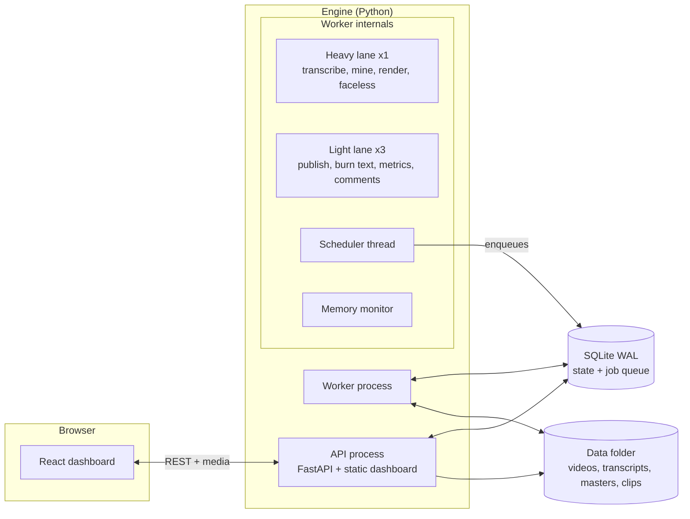
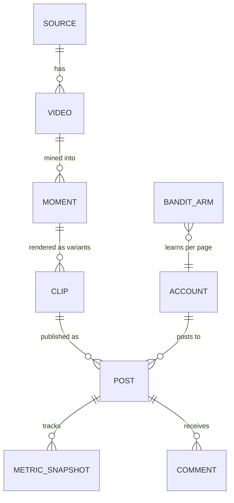

# 01 · System overview

## Processes

`autoshorts up` starts two long-running processes and supervises them (restarting either if it exits):



- **API process** serves the REST API, media files (clips, previews, scene images) and the built dashboard. It never runs models, so the UI stays responsive while the worker is busy.
- **Worker process** claims jobs from the queue. The *heavy* lane has one slot because each heavy job needs most of the machine's memory (a model or a render). The *light* lane has three slots for network and quick jobs.
- **Scheduler** (inside the worker) enqueues periodic work: watching sources, due posts, pulling metrics, fetching comments, nightly learning, token refresh and cleanup.
- **Memory monitor** (inside the worker) reports RAM use and loaded models, frees cached models after a few idle minutes, and handles "free memory" requests from the dashboard.

The two processes communicate only through the database: the API writes rows (jobs, settings, edits) and the worker picks them up. This keeps the API stateless and means either process can restart without losing work.

## Storage

Everything lives in one data folder outside the repository (`~/Library/Application Support/AutoShorts` on macOS, `%LOCALAPPDATA%\AutoShorts` on Windows, `~/.local/share/autoshorts` on Linux):

```
autoshorts.db        SQLite: sources, videos, moments, clips, posts, metrics, jobs, settings, bandit arms
library/            downloaded source videos
work/<video>/       transcript, timeline, masters/, faceless project files (script, shots, voice lines)
clips/<video>/      review drafts (*_base.mp4), final burned clips, thumbnails
voices/             uploaded voice samples and designed-voice references
music/              your licensed tracks and generated beds
secrets/            OAuth tokens (0700)
```

### Data model



- **Source**: where videos come from, plus the rights record (own, licensed, creator permission, clipping campaign), credit text, CTA keyword and auto-publish rules. Nothing is processed without a rights record.
- **Video**: one long video: file, transcript path, language, status and progress.
- **Moment**: a candidate clip, with start/end, title, hooks, LLM scores, lines to drop, cached edit plans and cached masters.
- **Clip**: one rendered variant of a moment: hook, caption style, edit preset, opening, QC results, live text overrides and the render stats the dashboard needs for its live preview.
- **Post / MetricSnapshot / Comment**: publishing and feedback.
- **Job**: the queue itself (kind, payload, lane, priority, attempts, progress, cancel flag).
- **Setting**: key/value configuration, editable from the dashboard.

## Job queue

The queue is a table, not a broker. `claim()` picks the highest-priority runnable job in a lane and flips it to `running` with a conditional update (`... WHERE id = ? AND status = 'queued'`) inside one transaction. If another thread got there first, the update touches zero rows and the claim simply returns nothing, so two workers never run the same job. Tasks register with a decorator:

```python
@task("render_moment", lane="heavy", max_attempts=2)
def render_moment(ctx: JobContext, p: dict) -> None: ...
```

`JobContext` gives each task progress reporting and cooperative cancellation (`ctx.progress()` raises `Canceled` when the user cancels). A task can raise `Retry` to come back later (for example, publishing waits for its clip's final burn). On startup, jobs left `running` by a crashed worker go back to the queue, and long faceless builds resume from cached files instead of starting over.

**Why a SQLite queue instead of Redis/Celery:** the app is single-machine and installed by non-developers. One file holds all state, there is nothing extra to install or keep running, and jobs survive restarts.

## Security

The engine only ever runs on your own machine, but other software on it, or a web page you visit, could still try to talk to it. `api/security.py` puts three checks in front of every request:

1. **Host check.** Requests must be addressed to `localhost`, `127.0.0.1` or `::1`. This blocks DNS rebinding, where a malicious site points its own domain at 127.0.0.1 to reach local services.
2. **Access token.** A random per-install token is created in `secrets/api_token` (readable only by you). `/api/*` and `/media/*` require it, either as an HttpOnly, SameSite=Strict cookie, which the dashboard page sets when it loads, or as an `X-AutoShorts-Token` header, which the macOS app and the dev proxy send. Other sites can't use the cookie. Only `/api/ping` and the OAuth redirects (which validate their own `state`) are open.
3. **Scoped tunnel.** Instagram's API fetches videos from a public URL. The temporary Cloudflare tunnel points at a separate tiny server whose only route is a signed, expiring clip link (HMAC-SHA256, compared in constant time), never at the dashboard.

Unhandled errors return a short reference ID to the client; the details go to the log.

## Dashboard

The dashboard is a single-page React app that the engine serves. Pages: Today, Videos, Faceless studio (and storyboard), Review, Schedule, Pages (accounts), Analytics, Comments, Optimizer, Viral finder, Rights, Activity and Settings. It polls lightweight endpoints (every few seconds) rather than using websockets, which keeps the server simple and is enough for this workload.
