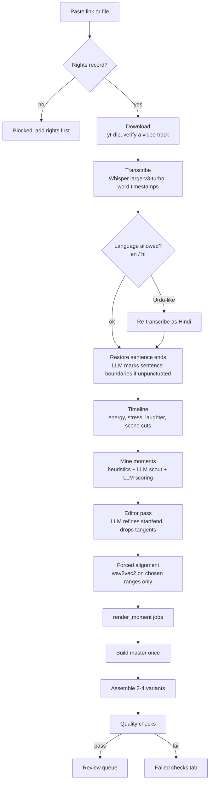

# 02 · Clip pipeline

What happens after a link is pasted. Each box is a stage of the `process_video` job (heavy lane), followed by one `render_moment` job per selected moment.

## 1. Download

`yt-dlp` fetches the best video and audio (or a local file is registered as-is). The downloader checks that the result actually has a video track: a dropped connection can leave an audio-only file, which would otherwise be mistaken for a podcast and rendered as an audiogram.

## 2. Transcription

Whisper large-v3-turbo produces segments with word-level timestamps. A punctuated `initial_prompt` nudges it to emit punctuation. Long files are processed in chunks.

**Language guard.** Only English and Hindi are allowed. Whisper often labels Hindi speech as Urdu (they sound the same), which would produce Urdu script captions. When the detected language isn't allowed, the audio is re-transcribed with the nearest allowed language forced (Urdu, Punjabi and similar map to Hindi).

## 3. Sentence restoration

Hindi transcripts often come back with almost no punctuation, which breaks everything downstream that thinks in sentences. When that happens, the LLM reads the transcript in windows and marks which words end a sentence (it never rewrites words). Example from a 1,689-word Hindi episode: 75 sentence ends restored.

## 4. Timeline signals

From the audio and video: loudness energy, per-word acoustic stress (loudness against the rest of the sentence, vowel lengthening and a pause right after the word; function words never count), laughter, and scene cuts (PySceneDetect). These feed both moment scoring and the editor (punch-ins land only on stressed words).

## 5. Finding moments

Three passes, cheapest first:

1. **Heuristic candidates.** Windows of 25-50 s scored by signals: questions, numbers, strong words, energy peaks, laughter.
2. **LLM scout.** The LLM skims overlapping transcript sections like an editor and proposes arcs it would cut, including ones the heuristics miss.
3. **LLM scoring.** Each candidate is scored 0-10 on hook, standalone sense, emotion, surprise, value, payoff and quotability. The result is combined with the signals and a learned predictor into a final score.

## 6. The editor pass

The best candidates go through one more LLM pass with surrounding context (about 10 lines before and 15 after). The model returns:

- the best start and end lines (so a clip opens on the hook question and runs until the answer is complete)
- lines to drop (tangents, repeated phrases)
- the structure (question then answer, claim then proof, story then lesson)
- whether it makes sense alone and whether the thought is complete
- the strongest opening line (used for the hook and cold open)

Clips that don't make sense alone are rejected. Boundaries then snap to sentence edges, with Hindi-aware rules (a sentence that starts with a postposition such as "ने", "को", "से" or "में" is really the tail of the previous one, so a clip never starts or ends there). If strict filters leave a video with no clips, the best near-misses are kept so the user always gets something to review.

## 7. Forced alignment

Whisper's word timestamps come from attention patterns and drift by up to a few hundred milliseconds, so a cut can land mid-word. Only for the chosen ranges, a wav2vec2 CTC model aligns the transcript to the audio with Viterbi decoding, giving accurate start and end times for every word. This keeps jump cuts and karaoke captions frame-accurate.

## 8. Variants and rendering

`plan_variants` picks 2-4 distinct versions per moment: different hook text and style, caption style, length (full or tight), opening (straight, cold open) and edit preset. The first variant uses the bandit's current best arms and the rest explore. Rendering is covered in [03 · Editing engine](03-editing-engine.md).

## 9. Quality checks

Every rendered variant is checked before anyone sees it:

| Check | What it catches |
|---|---|
| file / format | missing output, wrong resolution or codec |
| duration | outside the platform's limits |
| no_black_frames | failed B-roll or decode glitches |
| loudness | not near -14 LUFS |
| face_in_frame | framing that cut the speaker off |
| no_mid_word_cuts | a cut inside a word |
| captions_in_sync | caption timing drift |
| hook_in_first_3s | speech and the hook card don't start immediately, or the opening is weak |
| no_dead_air | silences longer than 1.5 s |

Failing clips never reach the review queue automatically; they sit under **Failed checks** with the reason.
