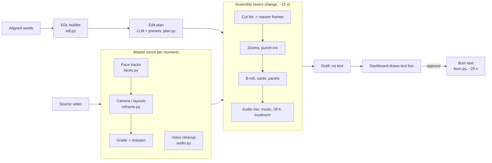

# 03 · Editing engine

The editing engine turns a moment (a time range plus metadata) into a vertical 1080x1920 clip. It lives in `backend/autoshorts/render/`.

## Edit decision list (EDL)

`edl.build()` turns the word list for a range into segments of source time to keep:

- **Jump cuts**: pauses longer than `max_pause_s` are removed.
- **Fillers and stutters**: hesitation sounds ("um", "uh", "hmm") and immediate word repeats are cut out.
- **Leading fillers**: a clip never starts on a weak opener ("so", "and", "but", "तो", "मतलब", "matlab").
- **Dropped lines**: ranges the editor pass marked as tangents are excluded.
- **Cold open**: the strongest line can be moved to the front as a teaser, followed by the clip from the start.
- **Safe padding**: cut points get a little breath before and after words, clamped so they never overlap neighbouring words (Hindi transcripts often have overlapping word timestamps).

The EDL maps output time to source time both ways, so captions, zooms and audio all agree on where each word is.

## Edit plan and presets

An LLM call (cached per moment and preset) suggests the headline, phrases to punch in on, emphasis words, a key card (stat, list, question or title), B-roll ideas, music mood and the end CTA. `plan.schedule()` then places everything on the timeline deterministically:

- **Framing changes** happen only at natural boundaries (sentence ends, pauses), every 3-5 s, cycling between wide and closer framings.
- **Punch-ins** land only on acoustically stressed words, at most a couple per clip in the clean preset.
- **Presets**: *clean* (default, restrained), *hype* (more zooms, bolder captions, SFX), *minimal*, *explainer* (motion-graphic panel on top, speaker below).

## Reframing (16:9 to 9:16)

1. Faces are detected at 5 fps on a small proxy (Apple Vision on macOS, YuNet elsewhere) and linked into tracks.
2. The **active speaker** is the track whose mouth moves most while someone is talking, with hysteresis so the camera doesn't flicker between people (a minimum hold of 1.4 s and a confirmation delay before switching).
3. Each shot between scene cuts gets a layout:
   - **follow**: crop around the speaker, with smoothing and a dead zone so small head movements don't move the camera
   - **split**: two speakers stacked when both are talking in a two-shot
   - **group**: everyone in frame
   - **screencast**: the full screen with a round speaker bubble
   - **fit**: the whole frame on a blurred background
4. Zoom is capped by face size (the face never fills more than about 30% of the height) and by upscaling (at most about 2.8x), so close-ups never look soft or cut off chins.

## Master and assembly rendering

Early versions rendered every variant from scratch (80-100 s each), so changing any setting meant waiting again. Now the work is split:

| | Master (once per moment) | Assembly (every variant or change) |
|---|---|---|
| Work | face tracking, camera plan, layout compositing, colour grade, sharpening, voice cleanup (high-pass, denoise, compression) | map the cut list to master frames, apply zooms by cropping the master, B-roll, cards, panels, music, SFX, loudness |
| Output | 1296x2304 video (1.2x the output size, so zooms stay sharp) plus a cleaned voice WAV and a per-frame track of layout and face position | 1080x1920 draft |
| Time | ~55 s | ~15 s |

The master covers the moment plus 3 s either side, so trims and cold opens reuse it. It is cached in the moment's metadata and invalidated when the source changes (for example, a faceless storyboard rebuild).

## Captions

`captions.py` groups words into short chunks (2 to 8 words depending on the style, never stranding "the" or "and" at a chunk end, breaking at commas and sentence ends) and animates them per style:

| Style | Look |
|---|---|
| clean | words appear as spoken, stressed words in caps and colour |
| bold / pop | large uppercase, active word highlighted, pop-in scale |
| karaoke | the active word sits in a colour box |
| boxed | white box behind the active word |
| chip | small grey chips, explainer look |
| minimal | small, low on screen |

Captions move out of the way of the face: with the follow layout, the caption line is kept below the chin and eased smoothly when the speaker moves.

## Overlays

- **Hook card**: fully readable on frame 0, sized by text length, key word highlighted. After the hook seconds it shrinks into a persistent headline.
- **Cards and panels**: stats, lists and questions as motion graphics. The explainer preset puts them in a top panel with the speaker below.
- **Progress bar, emoji pops, credit line and end card**, plus a "Comment KEYWORD" card when a DM funnel is set.

## Live text editing

Text is the thing people change most, so it is never baked into the draft:

1. The draft render contains footage, zooms, cards and audio, but no captions, hook or headline.
2. The render stores an **overlay spec**: words with timings, styles, positions per frame, hook and headline text, and colours.
3. `OverlayPreview.tsx` draws the same text over the playing video in the browser, mirroring the Python layout rules, so edits to captions, hook, position, size, style or colour show instantly. Captions can be dragged up and down.
4. Edits are saved as overrides on the clip. On approval, `burn_clip` decodes the draft, draws the text layer with the same renderer used everywhere else, and re-encodes it (audio copied) in about 20 s. Publishing waits for the burn if needed.

## Audio

- Cuts are joined with 30 ms crossfades, so jump cuts have no clicks.
- The voice chain is a high-pass, an FFT denoiser and a gentle compressor.
- Music (your own tracks, or beds generated in code) is ducked under speech with a sidechain compressor.
- Loudness is normalised in two passes (EBU R128) to -14 LUFS and -1.5 dBTP, which is what YouTube and Instagram play back at.

## Text rendering

All on-screen text goes through one rasteriser (`text.py`), so preview and final output match:

- **macOS**: CoreText, which shapes every script and renders Apple Color Emoji.
- **Windows / Linux**: Skia with HarfBuzz shaping (`text_skia.py`). The Mac fonts the editor asks for are mapped to open look-alikes (Montserrat, Anton, Noto) downloaded once, and Devanagari and emoji fall back to system fonts glyph by glyph.
