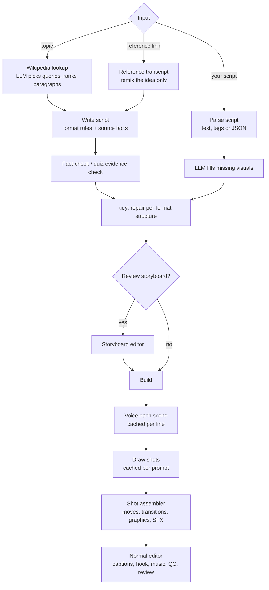

# 04 · Faceless studio

The faceless studio makes original videos with no camera footage. It reuses the editing engine for captions, hooks, music and publishing; what's new is how the base video is produced.

## Formats

Each format is a proven short-form template with its own writing rules, graphics, pacing and sound:

| Format | Structure | On-screen graphics |
|---|---|---|
| Story | hook, rising tension, twist, payoff | full-bleed scenes, 2-3 shots per scene |
| Top-N countdown | intro, items N to 1, outro | big number badge, item name chip |
| Rapid facts | intro, numbered facts, outro | number badge, key-phrase chip |
| Quiz | intro, question/answer pairs, outro | question card, A/B/C options, countdown timer, answer reveal |
| Would you rather | intro, dilemmas, outro | split screen A/B, OR badge, timer, "comment A or B" |
| Text story | post card, then story beats | post-style card on the intro |
| Quote | one powerful line per scene | large kinetic serif text over moody images |

Quiz and would-you-rather scenes get silent thinking time with a ticking sound, and the answer reveal gets a flash and a ding. Formats where the words are already on screen turn spoken captions off.

## Writing and accuracy

- The script is a structured object (`Script` with `Scene`s: narration, visual, second shot, kind, heading, number, options, answer, evidence), produced with JSON-schema-constrained LLM output.
- For factual topics, Wikipedia paragraphs that match the topic are passed in as **source facts**, and a fact-check pass rewrites any line the source doesn't support (line by line, so quiz options and countdown numbers aren't disturbed).
- **Quiz evidence**: every question must quote the source sentence that proves its answer. Questions whose quote isn't really in the source, or doesn't contain the answer, are dropped. This exists because a 9B model will confidently write wrong quiz answers.
- Future or hypothetical topics must be framed as predictions or "what if", never as fact. Text stories are labelled fictional in the caption.
- `tidy()` repairs what small models get wrong: renumbering countdown items, filling a missing question heading, clamping answer indices, and so on.

## Visual consistency

Image prompts put the style first (it carries the most weight), then the shot, then the recurring character and setting. Every shot uses the same seed, which keeps the drawing style and character design steady. Prompts forbid text, numbers, charts and signs, because image models fill those with gibberish.

## Voices

Voices are produced per scene so the timing of every scene is known exactly. Designed voices ("a deep, slightly gravelly documentary narrator") are generated from a description, which would sound like a different person on every call. So each designed voice is **generated once as a reference clip and then cloned** for every line (Qwen3-TTS VoiceDesign, then Qwen3-TTS Base). Measured median pitch across three lines went from 83-111 Hz (per-line design) to 101-102 Hz (locked).

## Shot assembler

`faceless_formats.assemble()` renders the base video:

- Scenes longer than ~2.6 s are split into 2-3 shots, alternating the scene's two images or a close crop, so there is a cut about every 2 seconds.
- Every shot gets a different camera move (push in, pull out, pans, tilt) with easing, plus a short punch on each hard cut.
- Scene changes get a whip (motion-blurred slide); quotes get slow fades instead.
- A soft vignette, format graphics, and a sound-design track (whooshes, hits, ticks, dings) are added. Music is mixed later by the editor.

## Storyboard and incremental rebuilds

Every expensive artefact is cached by its input:

| File | Rebuilt when |
|---|---|
| `script.json` | you edit it in the storyboard |
| `vo_KK.wav` + `vo.json` | that scene's narration text or the voice changes |
| `scene_KK.png` + `images.json` | that shot's prompt changes, or you click redraw |

So fixing one line re-voices one scene, redrawing one picture draws one image, and a restart resumes where it stopped. The storyboard page lets you review the script before anything is drawn (`review_script`), reorder, add or delete scenes, edit quiz options, and change the style or voice.

## Music

Background beds are synthesised in code (`render/music.py`): a chord progression per mood (chill, hype, emotional, suspense, inspiring, funny), a pad, bass, optional drums and a sparse pluck line, with a light stereo reverb. They are quiet, loopable and owned outright, so there is nothing to license.
