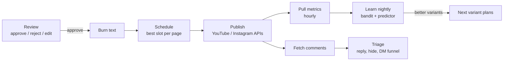

# 06 · Publishing and learning

## Review

The review queue is designed to clear in about ten minutes a day: a phone-sized player with safe-zone guides, keyboard shortcuts (J/K to move, A to approve, R to reject), swipe gestures on a phone, bulk approve, and the tabbed editor (Text, Edit, Post, Checks). Title suggestions come from the local LLM in ten different angles.

## Scheduling

Each connected page has posting slots in its own time zone (9:00, 13:00 and 19:00 by default). The bandit ranks those slot hours by how well they have performed for that page, and the clip takes the best free one. Variants of the same moment are pushed at least 48 hours apart on a page, and different pages get different variants where possible. Platform quotas are respected and failures retry with backoff.

## Publishing

- **YouTube**: OAuth per channel, resumable uploads through the YouTube Data API v3, title, description and tags from the clip.
- **Instagram**: Graph API for professional accounts. Reels are created from a public video URL; with Instagram-login tokens, a temporary Cloudflare tunnel serves the file just long enough for Instagram to fetch it.
- Tokens are stored locally and refreshed by a scheduled job.

## Metrics and learning

Metrics (views, likes, comments, shares, watch time where available) are snapshotted for each post. Every clip records the choices that made it: hook style, caption style, length bucket, opening, edit preset and posting hour.

- **Thompson-sampling bandit.** Each choice is an arm with a Beta distribution per page. A post "wins" if it beats that page's median at 72 hours. Variant planning samples from these distributions, so the system keeps exploring while leaning towards what works. The first variant of every moment uses the current best arms.
- **Predictor.** A ridge regression over moment scores and signals predicts each clip's views. It ranks clips in review and decides which clips auto-publish.

## Comments and DM funnels

New comments on your own posts are classified by the local LLM (question, praise, spam, abuse, keyword request). Replies are drafted in each page's voice for approval or sent automatically. Spam and abuse can be hidden. For a **comment-to-DM funnel**, a comment containing the page's keyword ("LINK") triggers an Instagram private reply with the configured affiliate link, and the clip's caption and end card tell viewers which word to comment.

## Notifications

Events (clips ready, posts published, failures, weekly report) appear in the dashboard feed, as desktop notifications in the Mac app, and optionally through a Telegram bot that also accepts `/status`, `/pause` and `/resume`.
